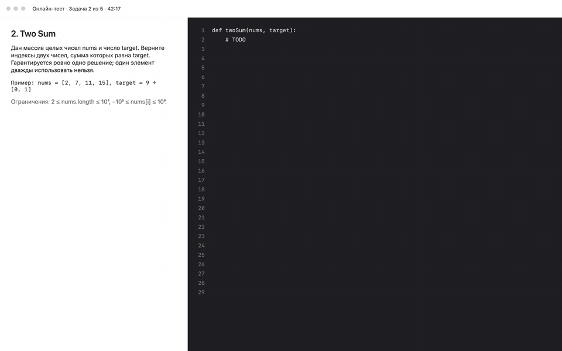
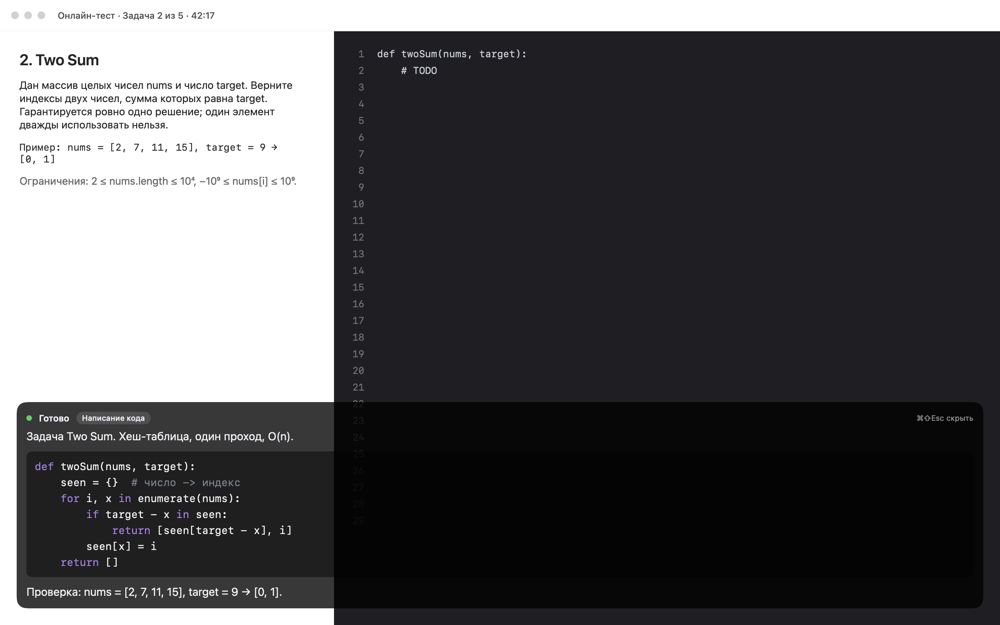
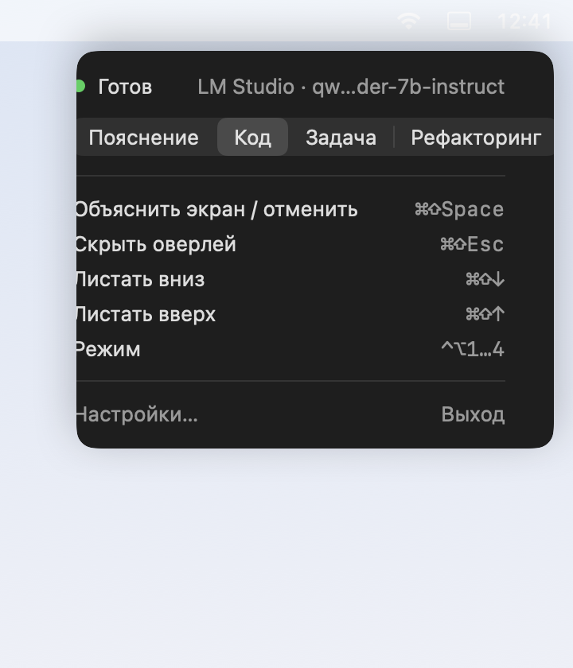
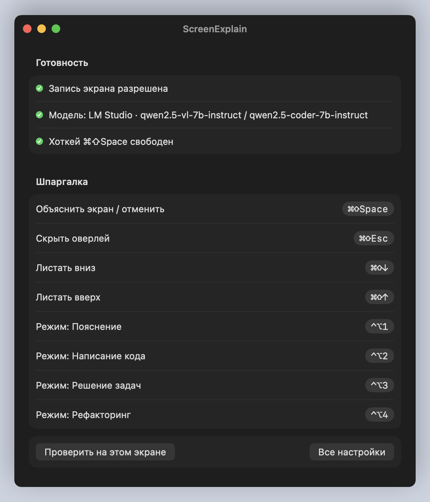

# ScreenExplain

**Подсказка на экране во время онлайн-теста или собеседования.** Нажимаете хоткей, приложение снимает экран, отправляет его в ИИ-модель и показывает ответ в полупрозрачной полосе внизу экрана: условие задачи разобрано, решение написано, код можно переписывать прямо из полосы. Полоса помечена как скрытая от демонстрации экрана, курсор из редактора не уходит.



## Зачем

Вы проходите кодинг-тест на HackerRank или решаете задачу на live-coding-звонке. Открыть ChatGPT в соседней вкладке нельзя: экран расшарен, а переключение окон видно. ScreenExplain решает это:

- **Один хоткей вместо копипаста.** Не нужно ничего выделять, фотографировать или печатать: снимок экрана уходит модели сам.
- **Ответ там, куда вы и так смотрите.** Полоса внизу экрана, крупный текст, подсветка кода. Фокус клавиатуры остаётся в редакторе теста, можно сразу печатать.
- **Ничего не уходит на сторону.** Модель локальная в LM Studio или ваш ключ OpenAI. Никаких аккаунтов, подписок и чужих серверов.
- **Четыре режима ответа**: объяснить, что на экране; написать код; решить задачу с разбором тестов; предложить рефакторинг.

Подходит и для мирных задач: быстро понять чужой код, незнакомый интерфейс или ошибку в логах, не отрываясь от окна.

## Как работает

1. По хоткею приложение снимает экран (или выбранное окно).
2. Vision-модель описывает, что на экране.
3. Кодовая модель отвечает по описанию с учётом режима, ответ приходит потоком.
4. Полоса внизу экрана показывает стадии («Снимаю экран», «Думаю… 6 с», «Отвечаю…») и ответ. Длинный ответ листается хоткеями или колесом мыши.

Приложение живёт в строке меню, иконки в Dock нет. Полоса появляется поверх всех окон, в том числе полноэкранных, и помечена как не участвующая в шаринге экрана (`sharingType = .none`); гарантировать, что конкретная программа записи это уважает, нельзя.

<p align="center">
  
</p>

<p align="center">
  
  
</p>

## Требования

- macOS 15.7 или новее.
- Xcode 26 или новее для сборки (готовых сборок пока нет).
- Модели: [LM Studio](https://lmstudio.ai) с vision-моделью (например `qwen2.5-vl-7b-instruct`) и кодовой моделью (например `qwen2.5-coder-7b-instruct`), либо ключ OpenAI.
- Разрешение «Запись экрана» в System Settings → Privacy & Security.

## Установка

```bash
git clone https://github.com/luckyevildev/ScreenExplain.git
cd ScreenExplain
xcodebuild -project ScreenExplain.xcodeproj -scheme ScreenExplain -configuration Release \
  -derivedDataPath .build CODE_SIGNING_ALLOWED=NO build
open .build/Build/Products/Release/ScreenExplain.app
```

Либо откройте `ScreenExplain.xcodeproj` в Xcode и нажмите Run.

## Первый запуск

При первом запуске открывается окно настроек с тремя строками готовности:

1. **Запись экрана.** Нажмите «Разрешить» и подтвердите системный запрос. После выдачи разрешения macOS перезапустит приложение.
2. **Модель.** По умолчанию используется LM Studio на `http://localhost:1234/v1`. Запустите LM Studio, загрузите vision- и кодовую модели, включите сервер (вкладка Developer). Для OpenAI переключите бэкенд в «Все настройки» и вставьте ключ.
3. **Хоткей.** По умолчанию ⌘⇧Space. Если занят другим приложением, строка подскажет, смените в «Все настройки».

Когда все три строки зелёные, нажмите «Проверить на этом экране»: полоса покажет ответ про само окно настроек.

## Хоткеи

| Действие | Сочетание | Когда работает |
|---|---|---|
| Объяснить экран / отменить | ⌘⇧Space (настраивается) | всегда |
| Скрыть полосу | ⌘⇧Esc | пока полоса видна |
| Листать ответ | ⌘⇧↓ / ⌘⇧↑ | пока полоса видна |
| Режим: Пояснение · Код · Задача · Рефакторинг | ⌃⌥1 … ⌃⌥4 | пока полоса видна |

Хоткеи полосы регистрируются только на время её показа, чтобы не мешать редактору. Режим можно менять и в панели строки меню.

## Настройки

«Все настройки» в окне настроек: бэкенд (LM Studio / OpenAI), адрес сервера или ключ, выбор vision- и кодовой модели из списка сервера, источник захвата (дисплей или окно приложения), хоткей, непрозрачность полосы (40–95 %) и размер шрифта (13–24 pt).

## Что и куда отправляется

- Снимок экрана уходит **только** на выбранный бэкенд: ваш LM Studio или `api.openai.com`. Никакой телеметрии и сторонних серверов.
- Ответ vision-модели (описание экрана) не показывается и нигде не сохраняется.
- Ключ OpenAI хранится в Keychain (связка ключей macOS) и уходит только на `api.openai.com`.

## Ограничения

- Снимок отправляется в полном разрешении. На Retina-экране с LM Studio и контекстом 4096 токенов модель может ответить ошибкой 400: увеличьте контекст в настройках модели в LM Studio.
- Скрытие полосы от записи экрана зависит от программы записи, см. выше.
- Глобальные хоткеи работают через Carbon API без разрешения Accessibility; если сочетание занято другим приложением, полоса и шпаргалка это покажут.

## Разработка

- Сборка и проверки: [CONTRIBUTING.md](CONTRIBUTING.md).
- Замысел интерфейса и причины решений: [docs/design.md](docs/design.md).
- Ручная проверка перед релизом: [docs/testing.md](docs/testing.md).
- Картинки для README генерируются из реальных вью приложения: `bash scripts/render-previews.sh`.

## Лицензия

[MIT](LICENSE).
